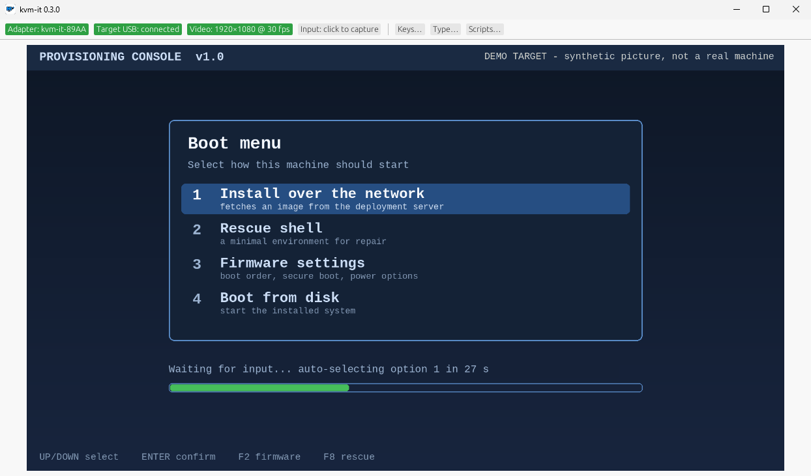
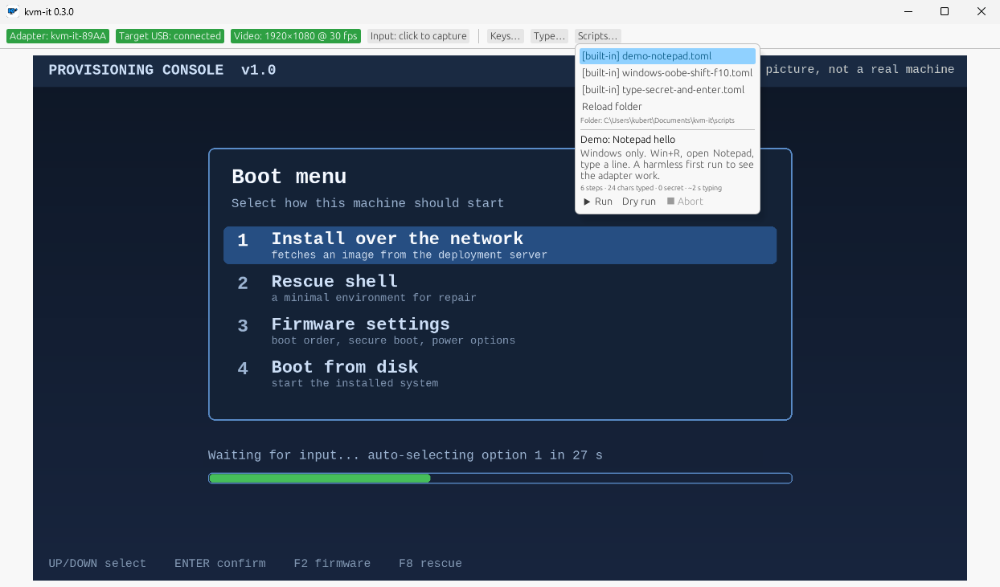
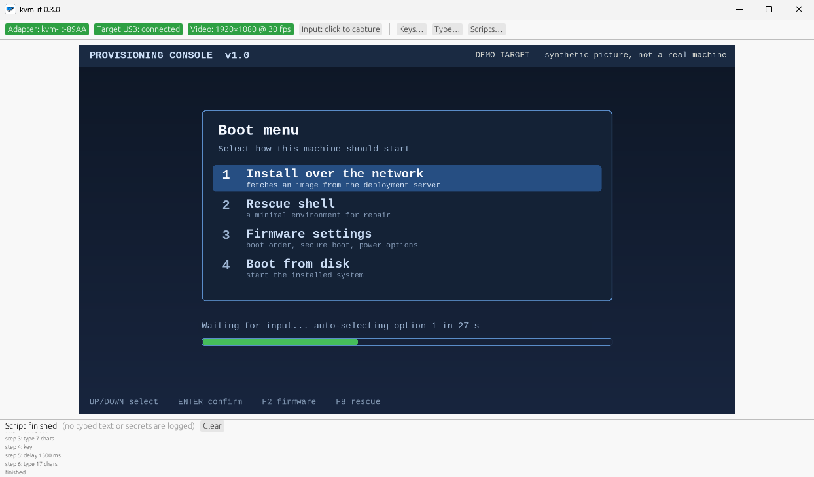

# UX principles

kvm-it is a tool a technician uses eight times in a row, hands busy, in front of a machine that might be at a
BIOS screen. The UX bar is "never make me think about the tool".

1. **Zero-step reconnect.** Moving the cables to the next machine is the whole workflow. BLE, capture and
   (later) trust all re-establish themselves; the UI shows state, it does not ask for action.
2. **State is always visible, never ambiguous.** One row of colour-coded chips: BLE link, target USB mounted,
   capture-card signal, input capture on/off. Green is working, amber is in progress, red is broken, grey is idle.
   Capture-active is unmistakable (red frame + a chip naming the release chord).
3. **Safe by default.** Releasing capture, losing focus, reconnecting or quitting sends release-all. The
   release chord is never forwarded to the target.
4. **Secrets are first-class.** Masked, never logged, per-run by default (see security.md). Typing a secret
   shows progress, never the text.
5. **Anything repeatable is one click** (macro buttons, scripts) and **anything running is interruptible**
   in one keypress, leaving the target with nothing held down.
6. **Honest feedback.** If a command was dropped, the BLE link is degraded, or a script step could not be
   confirmed, say so plainly — a KVM that silently mistypes a password is worse than none.
7. **Fast to first pixel.** Last-used capture device and mode are remembered; the preview appears before the
   user has found the mouse.

## Window layout (0.2.0)

The picture is the window. A single top bar holds everything else:

- **Adapter**, **Target USB**, **Video**, **Input**: status chips filled with their health colour. *Adapter*, *Video*
  and *Input* open the controls they describe (scan/pair/connect, device and mode, capture), and the *Input* chip
  starts capture when clicked. *Target USB* is an indicator only: a coloured label, not a button (screen readers and UI
  Automation still read it by name, "Target USB: ..."). A control that cannot be used right now is greyed out and says why on
  hover (no adapter, a script running, text the layout cannot type).
- **Keys**, **Type**, **Scripts**: buttons that open popups (chords the OS would swallow; typing a string, masked
  if secret; the script library, variables, preview, run and dry run). Popups stay open until you click outside.
- While input is captured only the *Input* chip is live: every key belongs to the target. The chip names the release chord as
  the keyboard labels it (Ctrl+Alt+Esc; Ctrl+Option+Esc on macOS). Where the controller's OS keeps its own shortcuts (Linux always;
  Windows if the keyboard grab cannot start; macOS without the Accessibility permission) the first capture says so once and
  points at *Keys*. The mouse wheel is forwarded in
  notches: pixel deltas (touchpads) are accumulated and sent as whole notches, line deltas as they are.
- **Record…** opens the recording popup (GIF, or WebM with optional sound; off by default, with a no-redaction warning). While recording it becomes a red **REC** chip, always live, one click to stop.
- **Theme** cycles auto (follows the system), light, dark; the choice is remembered. Status colours are chosen per mode and held to WCAG AA contrast (4.5:1) by tests.
- A running script's log is a strip along the bottom, with Abort, and outlives any popup. Its header reports the outcome,
  colour-coded: *Finished*, *Dry run finished*, *Aborted: reason* or *Failed: reason*. A dry run sends nothing, so it works
  without an adapter.
- Notices (amber line under the bar) can be dismissed, clear themselves when their cause goes away (e.g. video is showing
  again) or after 15 s, and never hide the adapter-link error, which has its own line. *Type* keeps your text until the run
  has actually started, and flags characters the US layout cannot type before you click.
- The chips and buttons are exposed to screen readers and UI Automation by name.
- The same window, words and safety on Windows, Linux and macOS; every place they differ, and how sure we are, is in
  [platform parity](platform-parity.md).


The script library, with a script's preview, variables and the Run / Dry run / Abort buttons; and the run log strip that
stays along the bottom after a (dry) run:

 

*The pictures on this site are of the real app (0.3.0, Windows 11) with a synthetic demo target in place of a real machine's screen, so nothing private is ever on show.*

# Scripting and replay

Goal (from the product owner): bundle replayable scripts, DuckyScript-style, to drive setup flows such as
Windows OOBE, installers and BIOS settings.

## Design decision

Chosen: **a small, structured, declarative script format run by the desktop app (controller side), with a
DuckyScript-compatible text importer, plus screen-aware wait steps.** Alternatives rejected:

- *Run scripts on the ESP32 (Rubber-Ducky style payload storage):* needs firmware changes per feature, no
  video feedback, secrets would have to live in flash, and it cannot adapt to a slow machine. The firmware
  stays a dumb, auditable HID endpoint.
- *A general scripting language (Lua/JS/Python) from day one:* power we do not need yet and a much larger
  trust/sandbox problem. The step model below can grow into one later without breaking script files.
- *Open-loop only (pure DELAY chains):* this is how OOBE automation breaks — one slow screen and every later
  keystroke lands in the wrong place. Because the app already has the HDMI frames, scripts can wait on the
  screen.

## Script file (native, TOML)

```toml
name = "Windows 11 OOBE — local account"
format = 1
description = "Region → keyboard → network → local account"

[vars]
wifi_ssid = { prompt = "Wi-Fi SSID" }
wifi_pass = { prompt = "Wi-Fi password", secret = true }   # asked at run time, never saved
user      = { default = "tech" }

[[steps]]
wait_for = { screen = "oobe-region.png", timeout = "90s", threshold = 0.9 }  # closed loop
[[steps]]
key = "ENTER"
[[steps]]
text = "{{wifi_ssid}}"
[[steps]]
secret_text = "{{wifi_pass}}"
[[steps]]
chord = ["CTRL", "SHIFT", "F10"]
[[steps]]
delay = "1s"
[[steps]]
confirm = "Is the desktop showing? Continue?"   # human gate
```

Step kinds: `text`, `secret_text`, `key`, `chord`, `delay`, `repeat`, `wait_for` (screen match, or
"screen stopped changing for N s", with timeout), `confirm` (human gate), `comment`. Variables via
`{{name}}`. No loops over arbitrary expressions, no shell, no file or network access from scripts.

## Stateful workflows (issue #46)

A script types and hopes. A **workflow** knows which screen it is on. It is a separate file (`workflow_format = 1`); linear
scripts are unchanged. Each state names the reference screens that identify it, what to type there, and which states may
follow. The engine loops **observe → classify → validate → act → verify → transition**:

- **Observe and classify:** the screen counts as a state only when it matches that state's reference at or above its
  threshold, beats the runner-up by the workflow's `ambiguity_margin`, and stays that way for two consecutive frames (a
  screen mid-animation does not count). Anything else is **unknown**: nothing is typed. The operator may fix the target by
  hand and continue, or stop.
- **Validate:** the state must be a permitted start (or the checkpoint's state, or what may follow it, on resume). A
  state's `require` guard compares `config` and `derived` values. `verify_tenant` checks that the screen shows the
  configured tenant's branding, and not another allowed tenant's, before acting. A `gate` asks the operator first.
- **Act:** the state's actions are the same steps a script uses, all compiled before the first key: a missing secret or an
  untypable character stops the run before anything is sent.
- **Done by hand:** a state with `manual = "..."` types nothing. The message is shown to the operator (connect the network,
  approve the sign-in on a phone), and the engine waits up to the state's `timeout`, watching, for the screen to move on
  to one of its `next` states. The screen moving on is the answer; there is no "continue" button. A manual state cannot
  have actions, a gate or retries. A state with neither actions nor `manual` simply waits for the target (checking for
  updates, a restart, enrolment).
- **Verify:** only the next screen counts as success, never a HID acknowledgement. The screen must settle on one of the
  state's `next` states within its `timeout`. Staying put is retried only when the state says `retry_safe = true` (at most
  5 retries). Landing anywhere else stops the run.

```toml
workflow_format = 1
name = "Windows 11 OOBE (Autopilot)"
start = ["REGION"]

[config]                        # the approved profile: immutable during a run
region = "United States"
deployment_mode = "autopilot"
tenant = "contoso"              # must be one of [tenants]

[secrets]                       # prompted at run time; never saved, logged or exported
wifi = { prompt = "Wi-Fi password" }

[tenants]                       # allowed tenants and their sign-in branding
contoso = "contoso-signin.png"

[[states]]
name = "NETWORK"
detect = { screen = "oobe-network.png", threshold = 0.92 }
next = ["AUTOPILOT"]
actions = [ { secret_text = "{{wifi}}" }, { key = "ENTER" } ]
timeout = "90s"
derive = { network_status = "connected" }   # recorded only once the transition out is verified

[[states]]
name = "AUTOPILOT"
detect = { screen = "oobe-autopilot.png" }
require = { deployment_mode = "autopilot", network_status = "connected" }
verify_tenant = true
gate = "Enroll this device into the tenant shown?"
next = ["DONE"]
actions = [ { key = "ENTER" } ]

[[states]]
name = "DONE"
detect = { screen = "oobe-desktop.png" }
terminal = true
```

The run's context keeps `config`, `observed` (classification, confidence, runner-up, reference, frame hash),
`derived` (with when it was verified), `runtime` (state, previous state, attempts, history) and secrets apart; the
inspector shows each value's source. Every step is a structured event (`StateObserved`, `StateEntered`, `GuardChecked`,
`TenantVerified`, `HumanGateRequested`, `ActionAttempted`, `TransitionVerified`, `ContextChanged`, `StateTimedOut`,
`Stopped`, `RunCompleted`), exportable as JSONL or as a Markdown note for a ticket. None of them carries typed text or a
secret. A **checkpoint** (no secrets, no images) lets a run resume, but only after the screen is observed again and
matches the checkpoint's state or a state that may follow it: never a blind replay. A dry run follows the frames it is
shown and sends no HID at all.

**Every burst of keys follows a fresh look taken at that moment**: the screen must settle again on the state, on frames
captured after that moment (frames arriving within the capture latency, 300 ms, may still be queued pictures and are
skipped), and the tenant check is repeated. Inside a workflow, actions may not `wait_for` or `confirm`, and may pause at
most 2 s in total: waiting and asking belong to states. The video source must number its frames (the app's capture cards
and the demo source do); a source that does not is refused. `secret_text`
may only use `[secrets]`. A state cannot list itself in `next`. Settling counts distinct captured frames (the capture's own
frame number), so a stalled capture never "settles", and a frame captured before an action never verifies it.

**Missing pictures** (0.5.1): a state none of whose reference pictures is saved cannot be recognised. A live run with
such states is refused unless the operator accepts it (**Run without the missing pictures**, `--allow-missing-pictures`):
that screen, if it appears, is usually unknown (the run stops) but may be taken for a similar state. A dry run accepts it
by itself. The run lists those states when it starts. When a state checks the tenant, every allowed tenant's picture is
required. A picture name that breaks the path rule is always an error.

**Setup values** (`[[setup]]`, 0.5.1): a workflow may list which `[config]` values a person sets, each with a label,
optional help and either fixed `choices` (plain strings, or `{ value, label }`) or free text. The app's **Set up your
copy** (on a built-in) and **Approved profile** (on a file), and `kvmit workflow new|set|show`, offer exactly those and
change nothing else: the rewrite keeps the file's comments and layout and is refused unless the result parses to the same
workflow with only those values changed. The `tenant` value, when the workflow lists `[tenants]`, is the organisation's
name (letters, digits, `-`, `_`): a new name renames the configured tenant and points it at `tenant-<name>.png` beside
the old picture. The configured value must be one of a field's choices; a field names a `[config]` key once.

```toml
[[setup]]
key = "deployment_mode"
label = "How the device joins your organisation"
choices = [
    { value = "autopilot", label = "Windows Autopilot (the device is registered)" },
    { value = "work_account", label = "Work or school account (Microsoft Entra join)" },
]

[[setup]]
key = "tenant"
label = "Your organisation's short name"
```

Every workflow states how it compares screens (`match` is required). Use **structure** (`match = "structure"`:
normalised correlation of the light/dark pattern) for real screens: setup screens share their background and differ
mainly in text. Brightness alone (`match = "luma"`,
what `wait_for` uses) found Windows 11 OOBE screens 96-98 % alike. A state can compare only part of the screen with
`detect.region = [x, y, width, height]` (fractions).

**Reading the screen (0.6.0).** A state may be recognised by the **text** it shows: `detect.text = ["Is this the right
keyboard layout"]` (every phrase must be found) or a list of alternatives (`[["Updating"], ["Just a moment"]]`). The
text comes from the computer's own reader (Windows.Media.Ocr, Apple Vision, Tesseract on Linux), read in the state's
region, and is compared after normalising case, quotes and hyphens, allowing about one misread character in ten
(`text_threshold`, default 0.9; a phrase must start and end on word boundaries). Pictures become optional: a state with
text needs none where text can be read. The engine probes the reader once before the first look; a state with neither
readable text nor a saved picture is blind, and handled as a missing picture. Every read is bounded (4 s; Tesseract is
killed), and a check that decides keys refuses a frame older than `evidence_age` (3 s by default, at most 30 s), checked
once more right before the keys.

- **Organisation check by reading:** with `[config] tenant_domain` and a top-level `account` (the secret holding the
  sign-in), `verify_tenant` reads the page instead of comparing branding: it must show, as one whole word, exactly the
  account typed (case aside), in that domain. The sign-in itself must be an address in the domain before the run
  starts. A live run that needs this check refuses to start where text cannot be read.
- **Read-back before Enter:** `verify_typed = "<secret>"` with `submit = [ { key = "ENTER" } ]` types the actions, then
  requires a fresh, settled look at the state whose region shows the value as a whole line, exactly (case-sensitive,
  spaces ignored), before sending `submit`. Shown with its case swapped stops naming Caps Lock; anything else stops
  naming the keyboard layout. Windows OCR drops the letter under a text cursor, so the built-in workflow presses Home
  first.
- **First use:** a `[config]` value left empty for a `[[setup]]` field with choices is unchosen; the run, and `workflow
  new`, refuse until it is chosen.
- **Runs, laptops and recovery:** a run may name its laptop (`--laptop`, **This laptop**); the checkpoint records it, and
  Resume is refused on another name. Every live run saves its record in `runs/`. A live run holds an operating-system
  lock on its slot for its lifetime and records its progress through `Host::persist` before what depends on it (a state
  entered, a manual step handed over, keys about to be sent), stopping before the keys if it cannot. **Recover** (the
  app, `--recover`) turns a run the app or computer cut short into a checkpoint, and is refused while the run still holds
  its lock.

**VM-verified (2026-11-02):** the first four Windows 11 25H2 OOBE screens, on a Proxmox VM through a QEMU harness (keys via
`qm sendkey`, screen via `screendump`), recognised and verified end to end. Not hardware-verified.

**In the app (2026-11-02):** workflow files in the scripts folder appear in the Scripts list as `[workflow] name.toml`.
Selecting one shows its states, its approved profile (read-only, or a form for its setup values: **Set up your copy** on
a built-in, **Save profile** on a file), a password box for each prompted secret in the order the run types them (held in
memory only, cleared when the selection changes), and Run, Dry run (needs a video source: it still watches the screen), Resume
(after a stopped run with a known state: it looks at the screen first) and Abort (Esc works as for scripts). While it runs:
a state chip (current state and attempt), a timeline of entered states, keys sent, verified transitions, questions and
stops, and a variables table with each value's source. When it ends: **Save trace and notes** (JSONL and Markdown in the
scripts folder) and **Copy notes**. None of these contains a prompted secret. **Built and unit-tested (the chip, timeline,
export names, outcome).** Looked at on screen on Windows 11 at 150 % (2026-11-06, demo video, no adapter): the setup
form, Save my copy, Save profile, the secret boxes and the reference list; the panel scrolls inside the window. The
state chip, timeline and variables during a live run have not been looked at on screen.

**From the command line (0.5.0):** `kvmit run <workflow.toml>` does what the panel does. It prints the workflow, its
states and its approved profile, asks whether you wrote or reviewed it (`--yes` skips that), prompts for each secret
without echo, then prints every state entered, keys sent, transition verified, question, manual step and fact recorded,
as it happens, and the variables at the end. Questions are answered with y/N; Ctrl+C aborts and releases every key.
`--dry-run` sends nothing and still watches the screen. `--save-trace` writes the JSONL trace and Markdown notes to the
scripts folder. `--check` connects to nothing: it parses the file and lists every reference image as present or missing.
`--var` is refused for workflows: their values are the `[config]` and the prompted `[secrets]`.

**Resuming across runs (0.5.0):** when a live run stops in a known state, its checkpoint (no secrets, no images) is saved
under `<scripts folder>/checkpoints/`, one per workflow file **and adapter** (several targets can run the same workflow at
once, each on its own adapter, and a checkpoint is never resumed on another target), bound to that file's exact text. **Resume** in the app and
`kvmit run <file> --resume` both use it, so a run stopped in a terminal can be resumed in the app and the other way round.
A completed run deletes it; a dry run never writes one; an edited file never resumes an old checkpoint. Resume reads it
again at the moment you click, so a newer checkpoint saved by another run is never overtaken by an older copy. A live run
locks its workflow-and-adapter pair and sets the saved checkpoint aside **before it sends anything**: a second run of the
same pair is refused, and a resume starts only from the checkpoint as read while holding that lock, and only if it is the
one that was shown (adapter ids are compared without regard to case). If that run sends nothing (it
stops before recognising a screen), the checkpoint is put back. A run that crashed leaves its lock behind; the next run
says which file to delete, after checking the target. A run that
stopped while waiting on a manual step, and finds on resume that the step was done (the next screen is showing), records
that step's transition and facts and carries on; it sends nothing for it.

**Reference screens (0.5.0):** a workflow is only as good as its reference images, and they should come from your own
target. The panel lists them (**Reference screens**: present or missing, and which state or tenant uses each) and
**Save this screen as** writes the current video frame under the chosen name, beside the workflow. Walk one target
through setup by hand once, saving each screen; `kvmit video snap <path>` does the same from a terminal.

**Built-in: Windows 11 provisioning (0.5.0).** `[built-in workflow] windows-11-oobe-provisioning.toml` takes Windows 11
setup from the region screen to the user's first sign-in, by one of two paths chosen in its approved profile:

| `deployment_mode` | Path |
|---|---|
| `autopilot` | Windows Autopilot, user-driven: the organisation's sign-in after the network, user name, password, MFA by the user, enrolment status page, handoff |
| `work_account` | Not registered for Autopilot: licence (only if `accept_license = "yes"`), device name skipped (Windows keeps its generated name), **Set up for work or school**, user name, password, MFA, privacy choices by hand, enrolment, handoff (Microsoft Entra join) |

A device that shows the other path's screen stops the run before anything is typed there. The password is typed only after
the organisation's branding is checked on the password page (`[tenants]`). The user name and password are prompted
secrets. The network, MFA and privacy screens are `manual`. Its reference images live in
`<scripts folder>/oobe-win11/`. To use it for real, copy the file into your scripts folder, set the profile and tenant,
and save your own screens. Personal Microsoft accounts, Autopilot pre-provisioning (technician flow) and self-deploying
mode are not covered yet.

**Status: built and host-tested** against simulated targets (synthetic frames and a mocked host), including the
provisioning template's two paths end to end, the wrong-path stop and another tenant's page. **VM-verified
(2026-11-04, Windows 11 25H2, Proxmox VM with a network card, QEMU harness):** the work-account path from the region
screen to the work-or-school sign-in page, driven by the template itself with nothing done by hand: REGION → KEYBOARD →
SECOND_KEYBOARD → UPDATES (updates and a restart) → DEVICE_NAME (Skip: Tab, Enter) → SETUP_CHOICE (Down, Space,
Enter) → WORK_SIGNIN, each transition verified at 99.8-100 %, in about 7 minutes. With a network the network screen
does not appear, and this build showed no licence screen. **Not verified anywhere:** typing the user name or password
(the run stopped on the sign-in page), the licence, network, MFA, privacy, enrolment and handoff screens, the tenant
check, Autopilot, and any run with a capture card and an adapter. The app's workflow panel has not been looked at on screen. **While a run waits on a
manual step, the app's keyboard and mouse capture stays locked** (a run owns the input): do the step at the target, or
Abort, do it through the app, and Resume.

## DuckyScript import

`kvm-it script import payload.txt` converts the common subset (`REM`, `STRING`, `STRINGLN`, `DELAY`,
`DEFAULT_DELAY`, `ENTER`/`TAB`/arrows, `GUI`/`CTRL`/`ALT`/`SHIFT` combos, `REPEAT`) into the native format and
**lists anything it could not translate** rather than guessing. Layout-dependent characters go through the
selected keyboard layout abstraction, not the payload's assumptions.

## Run-time UX and safety

- **Preview before run:** shows step count, total typed characters (secrets counted, not shown), and any
  `text` that looks like a command. Scripts from files you did not write get an explicit "this will type
  commands into the target" confirmation — a script is remote code execution on the target by design.
- **Controls:** run / pause / step / abort (the GUI today has run, dry run and abort). Abort (and any error) sends
  release-all. **Esc aborts a running script** from anywhere in the window, even mid-typing on the target, except while a
  text field has focus (there Esc just leaves the field, so editing a variable can never abort a run by accident; use the
  Abort button). Plain Esc only: Ctrl+Alt+Esc stays the capture-release chord. While input is captured no script can be
  running, so Esc then belongs to the target.
- **Run log:** step names, timings, outcomes; never typed text or secret values.
- **Dry-run** against the live preview without sending anything (highlights what would be typed).
- **Library:** scripts are plain files in a folder (and a built-in set), so they can be versioned in git and
  shared. Signing/trust marks for shared scripts are a later consideration.
- **Recorder (later):** capture a live session into a script, with secrets automatically turned into
  prompted variables.

## Status (0.1.0)

Built and host-tested: native format, variables, `text`/`secret_text`/`key`/`chord`/`delay`/`repeat`/`click`/
`move`/`confirm`, `wait_for` (reference image or screen-stable), DuckyScript import, dry-run, preview with
command warnings, abort-releases-everything. Built-in scripts are templates; **none has been run against a
real OOBE**. Screen matching has only been tested on synthetic frames.

## Milestone placement

Native step engine and text/key/chord/delay/repeat land with the macro system (Milestone 10); the
screen-aware `wait_for`/`confirm`, DuckyScript importer and dry-run follow once video capture (Milestone 7)
and the GUI (Milestone 8) exist. Nothing here requires a protocol change: scripts compile to the same
key/mouse/release-all messages the live path uses.

## Unverified assumptions

- Screen matching reliability across capture cards, scaling and compression artifacts is untested; start with
  coarse change detection and downscaled perceptual comparison, and measure on real OOBE screens.
- OOBE-specific behaviours (e.g. Shift+F10 availability) vary by Windows build and are per-script content,
  not product behaviour.
